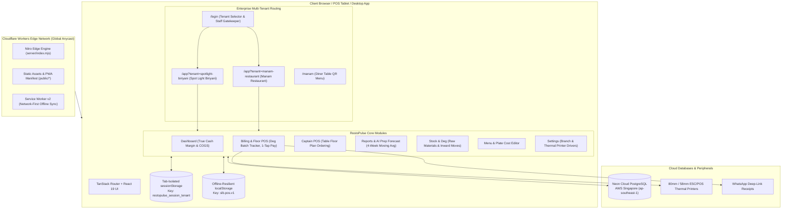

# 🥘 RestoPulse Multi-Tenant Platform — Master Guide, Diagrams & Business Playbook

**Platform:** RestoPulse Enterprise Cloud ERP & POS  
**Architect:** Manikandan Soundar  
**Live URL:** `https://restopulse.restopulse-cloud.workers.dev`  
**Edition:** Multi-Tenant Edge Architecture (Cloudflare Workers + Neon PostgreSQL)  

---

## 1. System Architecture & Tech Stack



---

## 2. Multi-Tenant Data & Role Isolation

### 1. Tenant Separation
RestoPulse powers multiple independent restaurant brands from a single consolidated codebase:
* **Tenant 1: Spot Light Biriyani (`spotlight-biriyani`)**
  - Specialization: Authentic Chennai Dum Biriyani (Chicken, Mutton, Kushka, Starters).
  - Outlets: Taramani (Flagship), Adyar, Velachery.
  - Operations: Daily 160-plate Deg batching and countdown depletion.
* **Tenant 2: Manam Restaurant (`manam-restaurant`)**
  - Specialization: South Indian meals, ghee roasts, tiffin, and dine-in hospitality.
  - Outlets: Velachery Central.
  - Operations: Dynamic QR table ordering (`/manam`) and floor plan management.

### 2. Session Isolation Mechanism
* Previous architectures using domain-wide `localStorage` suffered from cross-tab bleeding where logging into one tenant accidentally switched other open browser tabs.
* RestoPulse enforces **`sessionStorage` isolation**:
  - `restopulse_session_tenant`: Contains the active tenant identifier.
  - `restopulse_auth_role`: Contains the active staff role (`owner`, `cashier`, `chef`, `admin`).
* Each browser tab functions as an independent, sandboxed terminal.

---

## 3. High-Speed Counter POS Terminal Layout

```
┌────────────────────────────────────────────────────────────────────────────────────────┐
│  🔥 RestoPulse Cloud POS  ● Spot Light Biriyani   📍 Taramani ⌵   Neon Cloud   Logout │
├────────────────────────────────────────────────────────────────────────────────────────┤
│  [Dashboard]  [Billing & Floor POS]  [Captain POS]  [Reports]  [Stock]  [Menu] [Set]   │
├──────────────────────────────────────────────────────┬─────────────────────────────────┤
│  ● COUNTER POS  Token #33  Past Bills  KDS  Z-Report │  [🍽️ Dine-In]  [🥡 Takeaway]    │
│                                                      ├─────────────────────────────────┤
│  TODAY'S FRESH KITCHEN DEG BATCH                     │  Select Table / Floor Plan →    │
│  Cooked: 160 Plates | Sold: 64 | Left: 96 Plates     ├─────────────────────────────────┤
│  Depletion: [████████████░░░░░░░░░░░░] 40%           │  Item              Qty   Amount │
│                                                      │  Chicken Biriyani   2     ₹360  │
│  [All Dishes] [Biriyani (6)] [Kushka] [Starters]     │  Chicken 65         1     ₹210  │
│  ┌──────────────┐ ┌──────────────┐ ┌──────────────┐ │                                 │
│  │Chicken Biriyani│ Chicken 65   │ │Mutton Biriyani│ │  Total Net: ₹570                 │
│  │₹180          │ │₹210          │ │₹280          │ │  [ UPI ]  [ Cash ]  [ Card ]     │
│  │78 in Deg     │ │78 in Deg     │ │18 in Deg     │ │  [ 🖨️ SAVE BILL & PRINT (F2) ]   │
│  └──────────────┘ └──────────────┘ └──────────────┘ └─────────────────────────────────┘
```

---

## 4. Intelligent Night Day-Close & Prep Forecasting

The AI Prep Forecasting engine calculates kitchen requirements using a 4-week weighted average:
$$\text{Target Prep} = (0.4 \times \text{Week}-1) + (0.3 \times \text{Week}-2) + (0.2 \times \text{Week}-3) + (0.1 \times \text{Week}-4)$$

### Operational Execution Schedule:
| Time | Stakeholder | Action Taken |
| :--- | :--- | :--- |
| **10:00 PM** | Restaurant Owner | Runs Day-End Z-Report at `/app/billing`. Checks cash drawer balance. |
| **10:15 PM** | Head Chef & Owner | Reviews `/app/reports` "Prep Tomorrow" column. Determines exact kg of chicken, mutton, and rice needed. |
| **10:30 PM** | Procurement Mgr | Places purchase order to Koyambedu/wholesale meat vendors for early 5:00 AM delivery. |
| **05:00 AM** | Receiving Dock | Meat and groceries arrive. Head Chef logs inward quantity under `/app/stock`. |
| **07:00 AM** | Master Kitchen | Dum biriyani slow fire cooking begins. Deg capacity set in POS (160 plates). |
| **12:00 PM** | Billing Counter | Counter opens. Real-time batch depletion begins across Counter, Swiggy, and Zomato. |

---

## 5. Commercial SaaS Packaging & Market Valuation

RestoPulse is positioned to directly challenge legacy on-premise systems (Petpooja, Posist, ShawMan):

| Subscription Tier | Annual Price | Target Customers | Capabilities |
| :--- | :--- | :--- | :--- |
| **Single Outlet Starter** | ₹7,999 / year | Biriyani Kiosks & Small Takeaways | Counter billing, 80mm ESC/POS thermal printing, daily token generation, WhatsApp receipts, offline caching. |
| **Pro Kitchen Edition** | ₹14,999 / year | High-Volume Outlets (100–500 plates/day) | Everything in Starter + Live Deg portion tracking, raw material ledger, COGS margin engine, 4-week prep forecasting. |
| **Multi-Branch Franchise Cloud** | ₹24,999 / year | Restaurant Chains (3–10 Locations) | Everything in Pro + Multi-tenant isolation, cross-outlet consolidated reporting, centralized menu management, developer backup console. |
